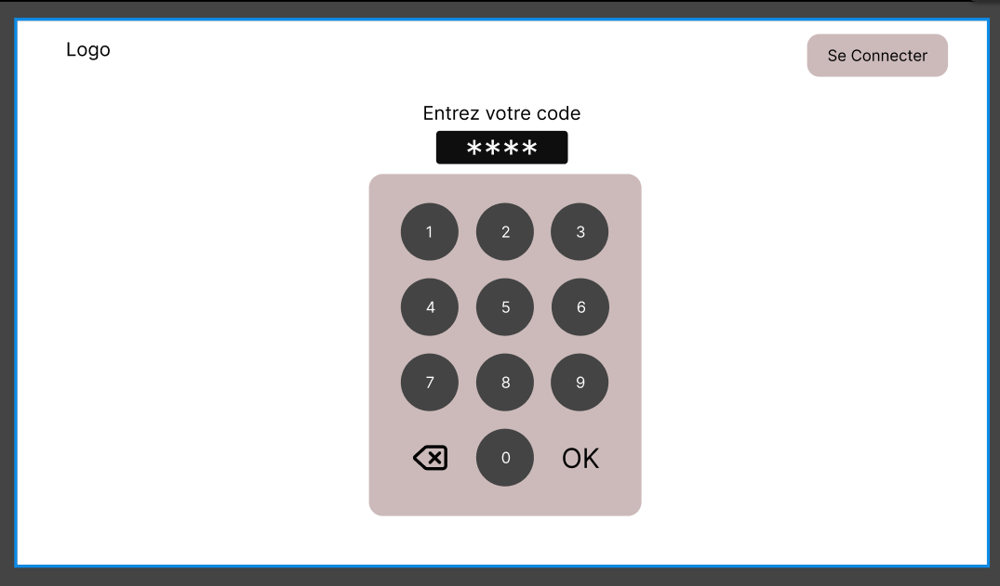
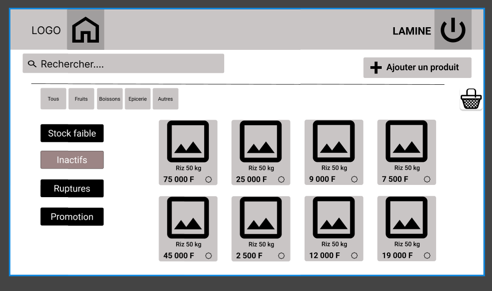
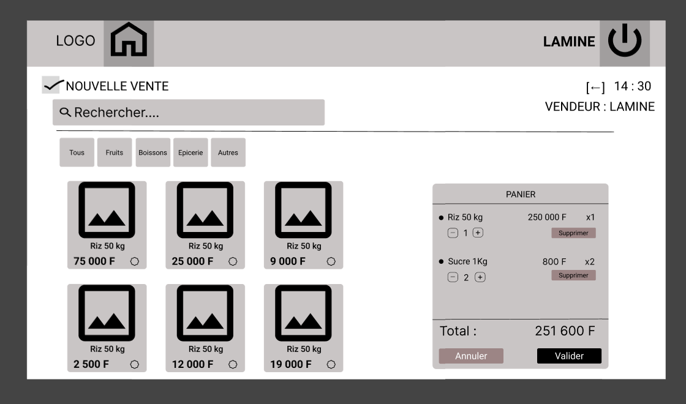

# 5. Maquettage et expérience utilisateur

## 5.1 Objectif et démarche

Avant le développement du MVP, j'ai réalisé des maquettes sur **Figma** afin de définir l'organisation des écrans et les parcours essentiels de PROJECT_POS. Le contexte d'utilisation — vente en boutique, parfois sur tablette — imposait une interface lisible et rapide à manipuler, y compris par des utilisateurs peu familiers des logiciels de gestion.

Sept écrans ont été conçus : connexion par PIN, accueil, catalogue, ajout de produit, détail produit, vente avec panier et paiement. Trois maquettes représentatives sont présentées ici pour illustrer les décisions de conception sans multiplier les figures. Il ne s'agissait pas de tests utilisateurs formalisés : aucune validation par panel n'est documentée à cette étape.

## 5.2 Parcours et choix d'interface

### Connexion par code PIN

*Figure 5.1 — Connexion par PIN : pavé numérique et saisie masquée.*

L'écran de connexion privilégie une saisie courte à l'aide d'un pavé numérique. Ce choix correspond au contexte d'une caisse partagée par plusieurs vendeurs. La maquette définit le parcours visuel ; la vérification du PIN et des droits est prise en charge par le backend, présenté dans les chapitres techniques.

### Consultation du catalogue

*Figure 5.2 — Catalogue : cartes produits, recherche et filtres.*

La grille permet d'identifier rapidement les articles. Les cartes regroupent les informations nécessaires à la consultation, tandis que la recherche et les filtres réduisent le temps passé à parcourir le catalogue. Les écrans d'ajout et de détail produit ont également été maquettés, mais ne sont pas reproduits ici : ils prolongent ce même parcours.

### Enregistrement d'une vente

*Figure 5.3 — Écran de vente : sélection des produits et panier latéral.*

Le catalogue et le panier sont visibles simultanément afin d'éviter des allers-retours entre plusieurs pages. Le vendeur peut sélectionner les articles, vérifier les quantités et consulter le total avant validation. Une maquette de paiement complète ce parcours de conception ; elle n'est pas reproduite ici pour conserver une présentation ciblée.

## 5.3 Passage des maquettes au MVP

Les maquettes ont servi de référence, sans figer l'interface. Pendant le développement, la présentation des cartes, la navigation selon la taille de l'écran et les fenêtres modales ont été ajustées. Le principe du **panier latéral** a été conservé pour la vente ; le catalogue a repris la logique de grille et de filtres.

Les captures de l'application réellement développée sont présentées au **chapitre 9**. Elles permettent de distinguer les intentions matérialisées dans Figma des écrans effectivement livrés. Les vues desktop et mobile du produit réalisé sont également pertinentes dans la section **8.10**, consacrée à l'ergonomie.

## 5.4 Bilan

Le maquettage a permis de fixer trois choix structurants : une connexion rapide par PIN, un catalogue visuel et un parcours de vente avec panier accessible en permanence. Ces choix ont guidé l'implémentation du MVP et fourni une base de conception pour la V1 React.
