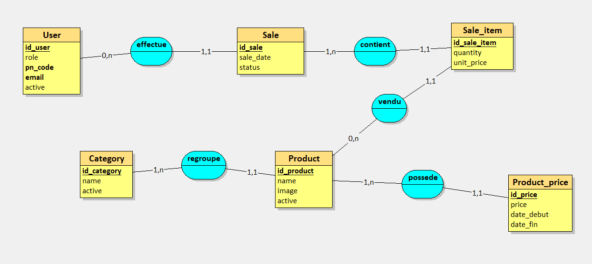
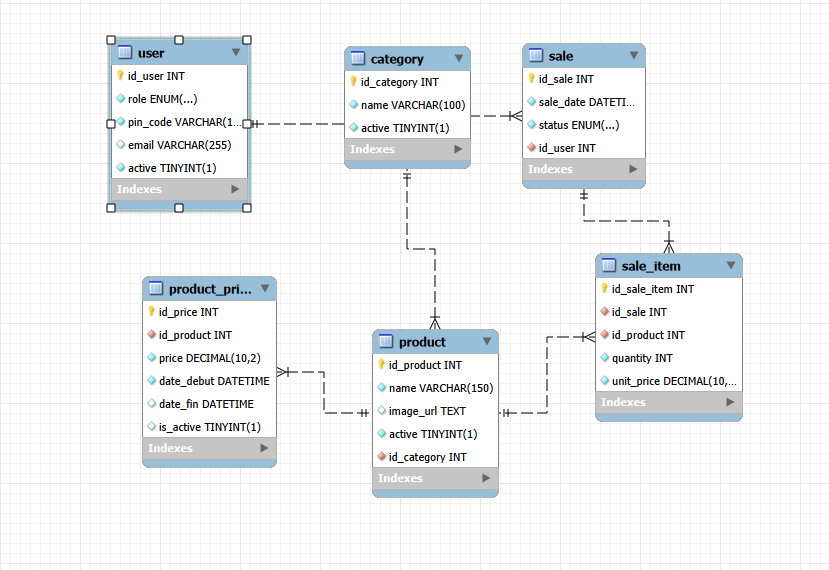
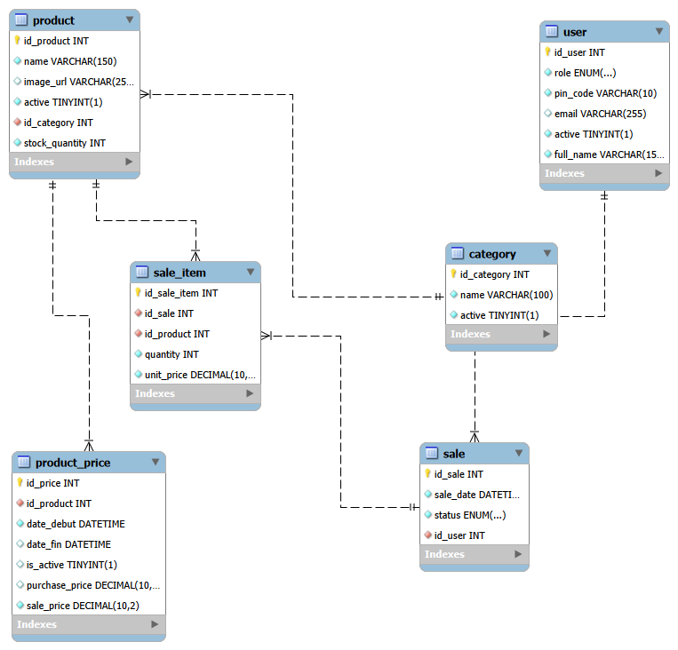

# 6. Modélisation des données

## 6.1 Traduction des besoins en règles de gestion

La base de données du MVP a été conçue à partir des opérations réelles d'une boutique : identifier un vendeur, organiser les produits, suivre leur stock, enregistrer les ventes et conserver les prix appliqués. La difficulté principale n'était pas de créer six tables, mais de garantir que les données restent interprétables après plusieurs transactions et changements de tarifs.

Les règles retenues sont regroupées par domaine :

| Domaine | Règles métier structurantes |
|---|---|
| Utilisateurs | Chaque utilisateur possède un PIN unique, un rôle (`VENDEUR` ou `GERANT`) et un état actif/inactif. Une vente est rattachée à son vendeur. |
| Catalogue | Un produit appartient à une catégorie ; une catégorie peut regrouper plusieurs produits. Le produit conserve une quantité disponible et un état actif/inactif. |
| Tarification | Un produit peut avoir plusieurs prix successifs, mais un seul prix courant doit être retenu pour une vente. Les anciens tarifs doivent rester consultables. |
| Vente | Une vente comporte des lignes associant produit, quantité et prix unitaire appliqué. Les états métier prévus sont `BROUILLON`, `VALIDEE` et `ANNULEE`. |
| Stock et traçabilité | La validation d'une vente diminue les quantités disponibles. Une modification ultérieure du catalogue ne doit pas modifier les montants d'une vente enregistrée. |

Ces règles ont conduit à séparer l'identité d'un produit, ses tarifs successifs et les prix réellement facturés. Ce sont trois informations différentes, qui ne doivent pas être confondues dans une même colonne.

## 6.2 Dictionnaire de données

Le dictionnaire décrit les attributs métier principaux. Les noms présentés ci-dessous correspondent aux propriétés Java ; les noms SQL physiques sont précisés dans le MPD.

| Entité | Attributs principaux | Rôle dans le modèle |
|---|---|---|
| `AppUser` | `id`, `fullName`, `email`, `pinCode`, `role`, `active` | Identifier l'utilisateur et son rôle lors d'une vente. |
| `Category` | `id`, `name`, `active` | Classer les articles du catalogue. |
| `Product` | `id`, `name`, `imageUrl`, `stockQuantity`, `active` | Décrire le produit et son stock courant. |
| `ProductPrice` | `id`, `purchasePrice`, `salePrice`, `startDate`, `endDate` | Historiser les prix d'achat et de vente. |
| `Sale` | `id`, `saleDate`, `status` | Identifier une transaction, sa date et son état. |
| `SaleItem` | `id`, `quantity`, `unitPrice` | Mémoriser les articles et les prix effectivement appliqués. |

Les références entre entités ne sont pas répétées dans ce tableau : elles sont matérialisées par les associations du MCD puis par les clés étrangères du MLD.

## 6.3 Modèle Conceptuel de Données (MCD)

Le Modèle Conceptuel de Données représente les informations métier indépendamment de toute considération technique.



*Figure 6.1 — MCD initial : entités et associations du MVP.*

Ce modèle fait apparaître une relation de plusieurs-à-plusieurs entre les ventes et les produits, résolue par l'entité `SaleItem`. Celle-ci porte les informations propres à chaque occurrence de vente : quantité et prix unitaire. Elle ne représente donc pas seulement une liaison technique.

Les cardinalités expriment les règles envisagées à la conception. Leur traduction effective dépend ensuite des clés étrangères, de leur nullabilité et des contrôles métier. Le nom `User` figurant sur le schéma correspond à l'entité `AppUser` dans le code Java.

## 6.4 Modèle Logique de Données (MLD)

Le passage au modèle relationnel transforme les entités en relations et les associations en clés étrangères. Dans le MVP, les relations logiques sont les suivantes :

| Relation | Clé primaire | Clés étrangères |
|---|---|---|
| `APP_USER` | `id` | — |
| `CATEGORY` | `id` | — |
| `PRODUCT` | `id` | `category_id` → `CATEGORY.id` |
| `PRODUCT_PRICE` | `id` | `product_id` → `PRODUCT.id` |
| `SALE` | `id` | `user_id` → `APP_USER.id` |
| `SALE_ITEM` | `id` | `sale_id` → `SALE.id` ; `product_id` → `PRODUCT.id` |

Deux transformations méritent d'être explicitées.

**La relation catégorie–produit (1,N).** La clé étrangère est portée par `PRODUCT` : chaque produit référence sa catégorie. Il n'est pas nécessaire d'enregistrer une liste de produits dans la table `CATEGORY`.

**La relation vente–produit (N,N).** Une vente contient plusieurs produits et un produit peut apparaître dans plusieurs ventes. La table `SALE_ITEM` porte donc deux clés étrangères. Elle possède également sa propre clé primaire, car chaque ligne constitue un enregistrement métier distinct, avec une quantité et un prix propres.

Les identifiants du tableau sont des noms *logiques*. Dans MySQL, la table utilisateur s'appelle `user` et les identifiants portent notamment les noms `id_user`, `id_category`, `id_product`, `id_price`, `id_sale` et `id_sale_item`.

## 6.5 Modèle Physique de Données (MPD)

Le MPD correspond à la traduction du modèle relationnel dans MySQL 8 : tables, colonnes, types et relations physiques. Deux états sont conservés pour montrer l'évolution entre la conception et la réalisation.



*Figure 6.2 — Premier MPD établi lors de la conception.*



*Figure 6.3 — MPD final obtenu par rétro-ingénierie du schéma `project_pos`.*

Le MPD final a été extrait de la base existante avec MySQL Workbench : il reflète donc les tables et relations présentes au moment de cette extraction, contrairement au premier diagramme qui décrivait la conception initiale.

| Point d'évolution | Effet sur le modèle physique |
|---|---|
| Stock | Ajout de `stock_quantity` au produit pour conserver la quantité disponible. |
| Utilisateur | Ajout de `full_name` pour identifier le vendeur dans l'application et l'historique. |
| Tarifs | Distinction entre `purchase_price` et `sale_price` dans `product_price`. |
| Validité des prix | Présence de dates de début et de fin, ainsi que de l'indicateur `is_active` dans le modèle final documenté. |
| Historique des ventes | Maintien de `unit_price` dans `sale_item`, indépendamment du prix actuel du produit. |

Les clés primaires identifient les enregistrements et les clés étrangères préservent les références entre tables. Les montants monétaires sont représentés par des types décimaux dans la conception physique. Le diagramme ne suffit toutefois pas à prouver toutes les contraintes métier : en particulier, l'unicité d'un prix actif relève aussi de la logique de mise à jour et des contraintes effectivement définies.

## 6.6 Deux décisions déterminantes pour la cohérence métier

### 6.6.1 Historiser les prix sans écraser le catalogue

Un prix n'est pas une propriété immuable du produit. Stocker uniquement le prix courant dans `product` ferait disparaître les anciens tarifs lors de chaque modification. La séparation `Product` / `ProductPrice` permet de conserver les versions successives.

Lors d'un changement de tarif, le service métier clôture l'enregistrement actif avant d'en créer un nouveau. Cette séquence est importante : deux enregistrements simultanément considérés comme actifs créeraient une ambiguïté au moment d'enregistrer une vente. Le chapitre 8 présente le traitement applicatif de ce changement, y compris l'incident rencontré autour de l'unicité du prix actif.

### 6.6.2 Figer le prix réellement appliqué à la vente

La table `sale_item` conserve `unit_price`. Cette colonne ne fait pas doublon avec `product_price.sale_price` : les deux champs répondent à des questions différentes.

- `product_price.sale_price` : quel tarif était proposé dans le catalogue pour une période donnée ?
- `sale_item.unit_price` : quel prix a effectivement été enregistré pour cet article dans cette transaction ?

Par exemple, une chemise vendue à **35 000 F** doit rester à **35 000 F** dans l'historique, même si son tarif passe ensuite à **37 000 F**. Le total historique se calcule à partir des lignes enregistrées : `quantity × unit_price`, et non en rejoignant le prix courant du catalogue.

Cette décision protège la traçabilité commerciale et évite qu'une simple mise à jour tarifaire modifie rétroactivement le chiffre d'affaires affiché pour une vente passée.

## 6.7 Intégrité et accès aux données

La cohérence des données repose sur plusieurs niveaux complémentaires : les relations SQL, les types de colonnes et les contrôles du service métier. Une clé étrangère peut empêcher une référence vers un produit inexistant ; elle ne suffit pas, à elle seule, à empêcher une quantité négative ou à garantir qu'un seul tarif est actif.

Le MVP utilise Spring Data JPA et Hibernate pour les opérations courantes de persistance. Les méthodes de repository dérivées permettent de transmettre les valeurs recherchées comme paramètres plutôt que de concaténer des saisies utilisateur dans une instruction SQL. Ce mécanisme réduit les risques d'injection dans ces accès, sans constituer une garantie générale pour toute requête native écrite manuellement.

Un compte MySQL applicatif distinct de `root` a également été utilisé. Le contrôle de ses droits a été réalisé avec :

```sql
SHOW GRANTS FOR 'lamine'@'localhost';
```

La configuration documentée lui attribue `ALL PRIVILEGES` sur le schéma `project_pos`. Ce choix fonctionne en développement, mais dépasse les permissions strictement nécessaires à une application exploitée en production. Les droits d'administration du schéma devraient alors être séparés des opérations ordinaires de lecture et d'écriture.

Ainsi, le modèle relationnel assure les liens entre les données, tandis que les règles de tarification et de vente sont appliquées dans les services. Les mécanismes d'authentification et de gestion des erreurs sont détaillés au chapitre 13.
