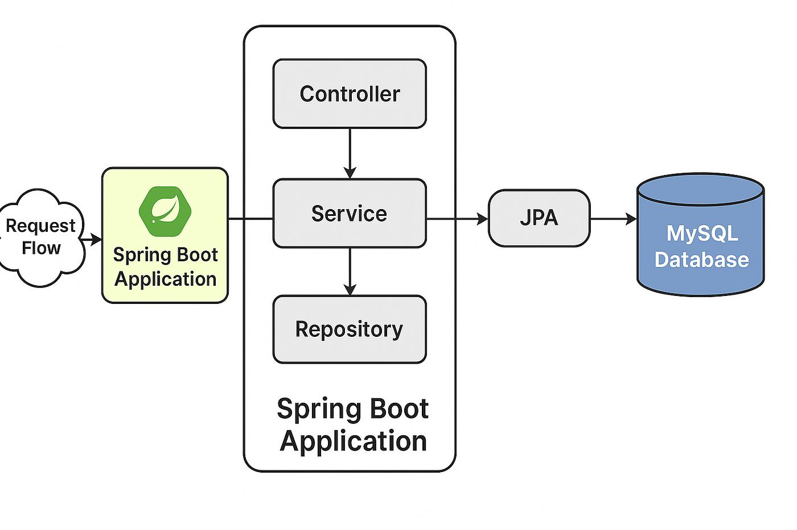
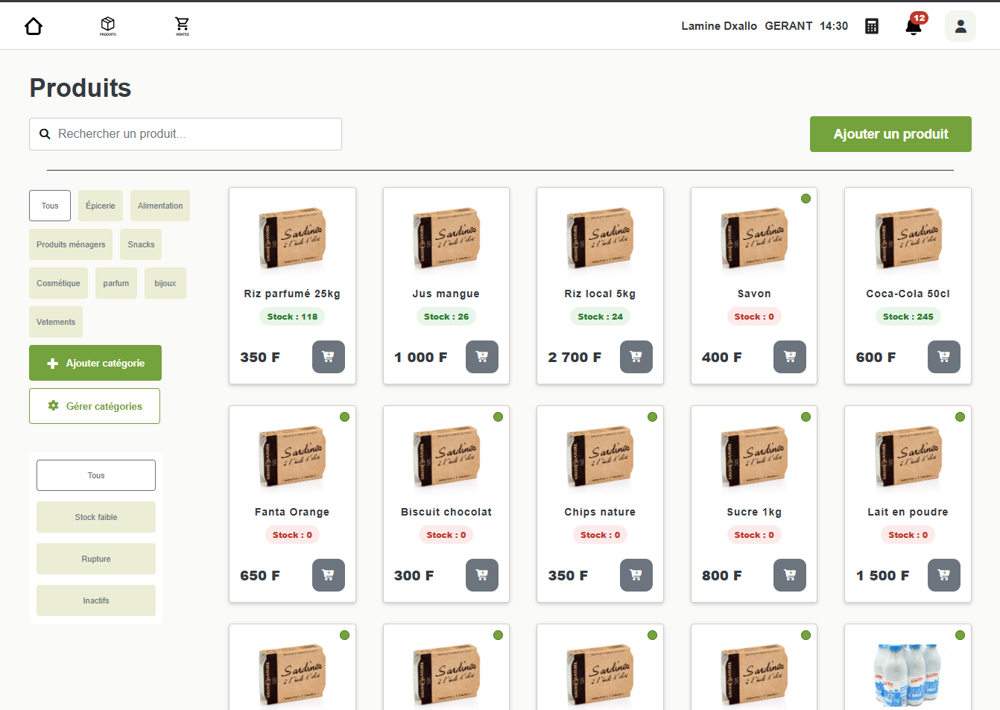
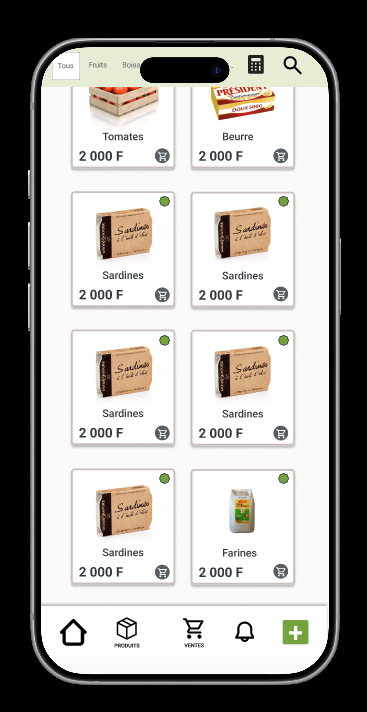

# 8. Réalisation du MVP

## 8.1 Objectifs et périmètre de réalisation

Le MVP (*Minimum Viable Product*) de PROJECT_POS constitue la première traduction opérationnelle des besoins recueillis auprès des commerçants. Son objectif était de disposer d'une application utilisable pour les opérations essentielles d'une boutique : gérer un catalogue, suivre les quantités disponibles, enregistrer les ventes et consulter les résultats de l'activité.

Le périmètre a été volontairement limité à **un commerce**, afin de stabiliser les règles métier avant d'aborder les problématiques de supervision de plusieurs établissements.

Les besoins, les parcours et les maquettes sont détaillés dans les chapitres précédents. Ce chapitre présente principalement **la réalisation technique** : l'organisation du code, l'implémentation des modules, les traitements qui assurent la cohérence des données et les difficultés rencontrées.

---

## 8.2 Architecture technique et organisation du code

### 8.2.1 Une application monolithique structurée

Le MVP a été développé avec **Java 21, Spring Boot 3.5.14 et MySQL 8**. Dans cette première version, le backend, les traitements métier, la persistance et le rendu des pages Thymeleaf appartiennent à une même application.

Cette architecture monolithique permettait de progresser rapidement sur les fonctionnalités essentielles sans introduire dès le départ la complexité d'échanges entre plusieurs services. Elle ne signifie pas pour autant que les responsabilités sont mélangées.

Le code est organisé par domaines fonctionnels :

- `user` : utilisateurs et authentification ;
- `category` : catégories du catalogue ;
- `product` : produits et traitements associés ;
- `sale` : ventes et lignes de vente ;
- `stock` : traitements liés aux quantités ;
- `shared` : éléments techniques transversaux.

Au sein des modules, les responsabilités sont réparties entre **contrôleurs**, **services métier**, **repositories** et **entités JPA**. Le contrôleur reçoit la requête, le service applique les règles de gestion et le repository assure l'accès aux données à travers Spring Data JPA et Hibernate.

### 8.2.2 Circulation complète d'une requête MVC

Le parcours d'une modification de produit illustre la séparation des responsabilités. L'utilisateur agit depuis une page Thymeleaf ; le navigateur transmet sa demande au contrôleur Spring MVC. Celui-ci récupère les données reçues, délègue le traitement à `ProductService`, puis restitue le résultat à l'interface. Le service applique les règles métier et utilise `ProductRepository` pour accéder à MySQL via JPA/Hibernate.



*Figure 8.1 — Parcours logique d'une requête dans le MVP monolithique.*

Après le traitement, le résultat remonte dans le sens inverse : MySQL → repository → service → contrôleur → navigateur. Ce schéma représente le parcours entre les couches, sans présumer d’une route HTTP particulière. La distinction essentielle est que **le contrôleur orchestre l'entrée et la sortie**, tandis que **le service porte les règles métier**. La réutilisation de ces services a ensuite facilité l'exposition d'API REST pour la V1.

### 8.2.3 Technologies d'interface et outils

Le frontend du MVP repose sur **Thymeleaf, HTML, Sass et JavaScript ES6**. Les fragments Thymeleaf permettent de réutiliser des éléments tels que les cartes produits ou certaines fenêtres modales. Les styles suivent une convention inspirée de BEM, tandis que les interactions sont réparties dans des modules JavaScript.

La bibliothèque **Chart.js** est utilisée pour les graphiques du tableau de bord. **Maven** gère les dépendances et la construction du projet ; **Git et GitHub** assurent son versionnement.

Spring Security fait partie de l'environnement technique. L'authentification effectivement décrite pour le MVP repose toutefois sur un code PIN et une session HTTP : cette implémentation ne doit pas être assimilée, sans vérification supplémentaire, à un dispositif complet de sécurité et d'autorisation.

---

## 8.3 Authentification et gestion des utilisateurs

### 8.3.1 Connexion par code PIN

Le terminal de caisse peut être utilisé par plusieurs personnes. Pour identifier l'auteur des opérations tout en limitant la saisie, le MVP utilise une **connexion par code PIN**.

Le traitement s'appuie sur la méthode `authenticate(pinCode)` du service utilisateur. Après identification, l'application conserve le contexte de l'utilisateur dans une **session HTTP**. Certains contrôleurs contrôlent la présence de l'attribut `currentUser` ; le module de gestion des utilisateurs prévoit notamment une redirection vers `/login` lorsqu'aucun utilisateur n'est présent en session.

Deux rôles métier sont prévus dans le modèle : `GERANT` et `VENDEUR`. Ils permettent de distinguer les profils, mais leur existence en base ne prouve pas, à elle seule, que chaque fonctionnalité est protégée par des règles d'autorisation.

### 8.3.2 Gestion des comptes et lien avec les ventes

Le module utilisateur repose notamment sur `AppUser`, `UserController`, `UserService` et `UserRepository`. Il prend en charge la consultation, la création et la modification des comptes, l'attribution d'un rôle et leur activation ou désactivation.

`UserService` centralise les vérifications d'unicité du code PIN. Lors de l'enregistrement d'une vente, la relation entre `Sale` et `AppUser` permet d'associer la transaction au compte concerné.

Ce lien constitue une première forme de traçabilité : il identifie l'auteur enregistré d'une vente, sans constituer un journal exhaustif de toutes les actions réalisées dans l'application.

**Limite identifiée.** Avant un déploiement réel, la protection des PIN, le contrôle des comptes inactifs, la limitation des tentatives de connexion et l'application effective des autorisations par rôle devront être vérifiés ou renforcés. Les aspects transversaux de sécurité sont traités dans le chapitre qui leur est consacré.

---

## 8.4 Gestion des catégories

Le module des catégories a servi de premier cadre de mise en œuvre des opérations de gestion de données. Il s'appuie sur les composants `CategoryController`, `CategoryService`, `CategoryRepository` et l'entité `Category`.

Les traitements couvrent la consultation, la création, la modification du nom et l'activation ou la désactivation d'une catégorie. Les données sont ensuite exploitées dans le catalogue et dans les formulaires associés aux produits.

Pour le contrôleur MVC décrit dans cette phase, les opérations de consultation, de création et de modification sont associées à la route `/categories` avec les méthodes HTTP GET, POST et PUT. Il convient de les distinguer de l'API `/api/categories`, développée ultérieurement pour préparer la V1.

L'intérêt technique de ce module tient à la **séparation des responsabilités** et à la réutilisation d'une organisation commune aux autres modules. La structure relationnelle entre catégories et produits est détaillée au chapitre 6 ; elle n'est donc pas reproduite ici.

---

## 8.5 Gestion des produits et du stock

### 8.5.1 Réalisation du catalogue

Le catalogue est au centre des opérations quotidiennes. Le module produit permet de créer et modifier les fiches, de les associer à une catégorie, de rechercher les articles et de prendre en compte leur état d'activation.

`ProductController` reçoit les demandes et délègue les traitements à `ProductService`, qui s'appuie sur `ProductRepository` pour la persistance. La gestion des tarifs est volontairement séparée dans `ProductPriceService` : un changement de prix ne doit pas être traité comme une simple modification des autres informations du produit.

L'interface Thymeleaf présente les articles sous forme de cartes. Certaines opérations s'effectuent dans des fenêtres modales, ce qui évite de quitter systématiquement le catalogue. La conception visuelle et les maquettes de ces parcours ont déjà été présentées au chapitre 5.

### 8.5.2 Gestion des quantités disponibles

Chaque produit possède une quantité courante enregistrée dans `stock_quantity`.

Deux opérations métier principales font évoluer cette valeur :

- **Réapprovisionnement** : ajout d'une quantité au stock disponible.
- **Vente validée** : diminution de la quantité selon les articles vendus.

Ces traitements permettent de maintenir une information de stock utilisable au moment de la vente. Ils ne constituent cependant pas un **journal des mouvements** : le seul champ de quantité courante ne retrace ni la date ni le motif de chaque entrée, sortie ou correction.

Cette limite est importante au regard des besoins de traçabilité exprimés pour les versions futures.

### 8.5.3 Évolution ultérieure vers les API REST

Après la stabilisation du MVP monolithique, le backend a été enrichi d'endpoints autour de `/api/products`, notamment pour consulter, créer et modifier les produits, ajouter du stock et changer un prix.

Des DTO tels que `CreateProduct`, `UpdateProduct`, `AddStock` et `ChangePrice` structurent les données échangées avec l'API.

**Cette étape est postérieure au MVP initial.** Elle est mentionnée ici pour expliquer la continuité du travail : les règles métier déjà développées ont pu être réutilisées pour préparer un frontend React, sans reconstruire intégralement le backend.

---

## 8.6 Historisation des prix

### 8.6.1 Mise en œuvre de la règle métier

Un prix de vente peut évoluer sans que les tarifs précédents doivent disparaître. Pour répondre à cette exigence, PROJECT_POS utilise une entité `ProductPrice` distincte de `Product`.

La règle recherchée est simple : **un produit ne doit posséder qu'un seul prix actif à un instant donné**, tout en conservant les enregistrements des périodes précédentes.

La logique est centralisée dans `ProductPriceService`, notamment au moyen des méthodes suivantes :

| Méthode | Responsabilité |
|---|---|
| `getActivePrice(productId)` | Retrouver le tarif actuellement applicable |
| `createInitialPrice(...)` | Enregistrer le premier tarif du produit |
| `closeActivePrice(productId)` | Clôturer le tarif actif |
| `changePrice(...)` | Coordonner un changement de tarif |

Lors d'un changement, le service doit clôturer l'ancien prix puis créer un nouvel enregistrement. Cette démarche préserve l'historique au lieu d'écraser le montant précédent.

### 8.6.2 Incident SQL rencontré pendant le développement

Cette fonctionnalité a donné lieu à un incident technique significatif.

Lors d'une modification de prix, l'application retournait une erreur HTTP `500`. Les journaux Spring Boot et Hibernate faisaient apparaître une violation de contrainte MySQL :

```text
SQL Error: 1062
Duplicate entry '1-0'
Index : ux_product_active_price
```

L'analyse a montré que le nouvel enregistrement entrait en conflit avec l'ancien prix : sa clôture n'avait pas encore été effectivement prise en compte par la base au moment de l'insertion.

La correction a consisté à **revoir l'ordre des opérations de persistance** pour que la clôture du prix précédent soit effective avant la création du nouveau.

Ce diagnostic a permis de mieux comprendre un comportement important de JPA : modifier une entité dans le contexte de persistance ne signifie pas nécessairement que l'instruction SQL correspondante a déjà été exécutée. La solution ne consistait donc pas à supprimer la contrainte, mais à faire respecter la règle métier par le traitement applicatif.

Après correction, les changements de prix ont été retestés avec Postman et vérifiés dans l'interface. Les résultats fonctionnels correspondants figurent au chapitre 9. Ces vérifications portent sur les scénarios testés ; elles ne démontrent pas à elles seules la résistance à des modifications simultanées.

### 8.6.3 Préservation des prix appliqués aux ventes

L'historisation des tarifs est complétée par une seconde règle : **chaque ligne de vente conserve le prix réellement appliqué** dans `SaleItem.unit_price`.

Ainsi, si un produit a été vendu à 35 000 F puis passe à 37 000 F, la vente passée conserve le prix de 35 000 F. Les reçus et les montants historiques ne dépendent donc pas du tarif actuel du catalogue.

Cette distinction entre **historique des tarifs** et **prix figé dans la transaction** est essentielle à la cohérence commerciale de PROJECT_POS.

---

## 8.7 Gestion des ventes

### 8.7.1 Du panier à l'enregistrement

Le module de vente constitue le principal parcours opérationnel du MVP. L'écran associe un catalogue visuel à un panier : le vendeur sélectionne les articles, ajuste les quantités et vérifie le total avant de confirmer l'opération.

JavaScript gère les interactions du panier côté navigateur. La validation définitive est confiée au backend, qui coordonne plusieurs traitements :

1. Identifier l'utilisateur associé à la transaction.
2. Récupérer les produits et les quantités sélectionnés.
3. Créer la vente (`Sale`) et ses lignes (`SaleItem`).
4. Conserver le prix unitaire appliqué à chaque ligne.
5. Mettre à jour les quantités disponibles.
6. Enregistrer les données et restituer les informations nécessaires au reçu.

```text
Sélection des articles
         |
         v
        Panier
         |
         v
  Validation de la vente
         |
         v
    Service métier
      /    |    \
     v     v     v
   Sale  SaleItem Stock
      \    |    /
         v
        MySQL
         |
         v
  Confirmation / reçu
```

Le modèle prévoit les statuts `BROUILLON`, `VALIDEE` et `ANNULEE`. Leur présence ne signifie pas nécessairement que toutes les transitions sont accessibles dans l'interface du MVP.

### 8.7.2 Cohérence transactionnelle

Une vente met à jour plusieurs données qui doivent rester cohérentes entre elles. Si l'enregistrement des lignes réussit mais que la mise à jour du stock échoue, la base risque de contenir une transaction incomplète.

La méthode de validation du service utilise **`@Transactional`**. Cette annotation définit une frontière transactionnelle pour les opérations concernées : lorsqu'un échec déclenche un rollback selon les règles de Spring, les modifications de cette transaction peuvent être annulées ensemble.

Cette protection est différente de la gestion des **ventes concurrentes sur un même stock**. L'annotation seule ne prouve pas que les contrôles de disponibilité, les verrous ou les mécanismes de concurrence sont suffisants.

### 8.7.3 Reçu et résultat de l'opération

Après validation, l'application affiche un reçu récapitulant la référence de vente, la date, les articles, les quantités, les prix unitaires et le montant total.

Ce reçu s'appuie sur les informations enregistrées pour la transaction. La capture fonctionnelle correspondante figure au chapitre 9.

La vente est donc le meilleur exemple d'**intégration des différentes couches du MVP** : interface JavaScript, service métier, relations JPA, persistance transactionnelle et stock interviennent dans un même parcours.

---

## 8.8 Historique des ventes

Le MVP propose une **page regroupant les ventes enregistrées**. La sélection d'une transaction ouvre une **fenêtre modale de détail** ; il ne s'agit pas encore d'un écran de recherche multicritère.

La modale présente la référence et la date de la vente, le vendeur et son rôle, le statut, les articles, les quantités, les prix unitaires et le total. Ces données proviennent de `Sale` et de ses lignes `SaleItem`, reliées à l'utilisateur et aux produits concernés.

Le champ `SaleItem.unit_price` restitue le prix effectivement appliqué à la transaction, même lorsque le tarif du catalogue change ensuite. Cet écran apporte une première traçabilité des ventes, mais **ne retrace pas les encaissements, versements et transferts financiers** entre boutiques. Les filtres avancés sont réservés à une évolution ultérieure.

## 8.9 Tableau de bord et indicateurs commerciaux

### 8.9.1 Indicateurs réalisés

Le tableau de bord exploite les transactions enregistrées pour donner une vision synthétique de l'activité. Le MVP présente notamment :

- le **chiffre d'affaires** ;
- le **nombre de ventes** ;
- le **nombre d'articles vendus** ;
- les **produits les plus vendus** ;
- l'**évolution des ventes** dans le temps.

Ces indicateurs permettent de passer de la consultation des transactions individuelles à une lecture globale de l'activité commerciale.

### 8.9.2 Préparation et affichage des données

Les calculs reposent principalement sur les données de vente et leurs lignes. Le montant d'une ligne correspond à la quantité vendue multipliée par le prix unitaire enregistré ; les agrégations permettent ensuite d'obtenir les indicateurs attendus.

Le backend Spring Boot prépare les données transmises aux pages Thymeleaf. La bibliothèque **Chart.js** prend en charge la représentation graphique des évolutions et des classements.

Les indicateurs de vente doivent distinguer les transactions validées des brouillons et des annulations afin de ne pas fausser les résultats. La logique exacte de filtrage dépend des requêtes utilisées par le tableau de bord.

Enfin, le chiffre d'affaires enregistré ne représente pas nécessairement les sommes réellement encaissées ou reversées. Cette différence est importante au regard du besoin métier de suivi des flux financiers. Les captures et contrôles fonctionnels du tableau de bord figurent au chapitre 9.

---

## 8.10 Ergonomie et interactions frontend

L'interface a été pensée pour les opérations répétitives d'une boutique : identifier rapidement un produit, le sélectionner et finaliser une vente avec un minimum de manipulations. L'utilisation tactile fait partie des contraintes prises en compte dès la conception.

### 8.10.1 Des maquettes à l'interface réalisée

La réalisation reprend les principes des maquettes du chapitre 5 : **catalogue visuel**, **actions accessibles rapidement** et **fenêtres modales** pour limiter les changements de page. Les fragments Thymeleaf mutualisent les composants d'interface, Sass/BEM organise les styles et les modules JavaScript ES6 pilotent les interactions.

| Version desktop | Version mobile |
|:---:|:---:|
|  |  |

*Figure 8.2 — Adaptation responsive de la page Produits : vues desktop et mobile de l'application.*

Sur desktop, le catalogue s'organise en grille multicolonnes avec les catégories et les filtres accessibles dans une barre latérale. Sur mobile, les cartes produits s'affichent sur deux colonnes, les catégories sont regroupées en haut de l'écran et une barre de navigation inférieure facilite l'accès aux fonctions principales. Les deux vues illustrent l'adaptation de la même fonctionnalité aux contraintes d'affichage et d'interaction des terminaux.

### 8.10.2 Objectif de rapidité et limites de validation

L'objectif initial était de permettre l'enregistrement d'une vente simple en **environ 30 secondes**. Il s'agit d'une cible de conception et non d'une performance mesurée.

Des essais sur différents terminaux, des mesures chronométrées et des vérifications d'accessibilité restent nécessaires pour évaluer précisément l'ergonomie en conditions réelles.

---

## 8.11 Bilan du MVP et transition

### 8.11.1 Résultats obtenus

Le MVP a permis de réunir dans une application Spring Boot les fonctionnalités essentielles de gestion commerciale : utilisateurs, catégories, catalogue, prix historisés, stock courant, ventes et tableau de bord.

Sur le plan technique, il a permis de mettre en pratique la structuration d'un backend par domaines, la séparation des couches applicatives, la persistance avec JPA, les traitements transactionnels et l'intégration d'une interface dynamique avec Thymeleaf et JavaScript.

Deux réalisations illustrent particulièrement la maîtrise acquise pendant cette phase :

- **L'historisation des prix**, avec le diagnostic puis la correction d'une violation de contrainte MySQL.
- **La validation des ventes**, qui coordonne plusieurs écritures métier au sein d'une transaction.

Les scénarios fonctionnels vérifiés et leurs preuves sont rassemblés au chapitre 9.

### 8.11.2 Limites retenues pour la suite

Le MVP constitue une première version centrée sur un commerce. Il ne couvre pas encore la supervision centralisée de plusieurs boutiques, le suivi détaillé des mouvements de stock ni la traçabilité complète des encaissements, des versements et des créances.

La sécurité, la concurrence sur le stock et l'ergonomie en conditions réelles nécessitent également des vérifications ou renforcements supplémentaires avant une exploitation à plus grande échelle.

Ces limites ne remettent pas en cause l'intérêt du MVP : elles précisent les fonctionnalités et les exigences à traiter lors des évolutions suivantes.

### 8.11.3 Continuité du projet

La version monolithique a été conservée comme jalon de référence avec le tag Git **`v1.0-mvp`**. La préparation des API REST a ensuite engagé la séparation progressive du frontend et du backend en vue de la V1 React.

L'organisation initiale du code par domaines fournit également un point de départ pour l'évolution ultérieure vers les microservices, présentée dans les chapitres dédiés.

Le MVP constitue ainsi **un socle fonctionnel et technique**, et non une simple démonstration visuelle : il permet de relier les besoins métier à des traitements persistés, tout en identifiant les étapes nécessaires pour faire évoluer PROJECT_POS vers une plateforme de supervision commerciale.
