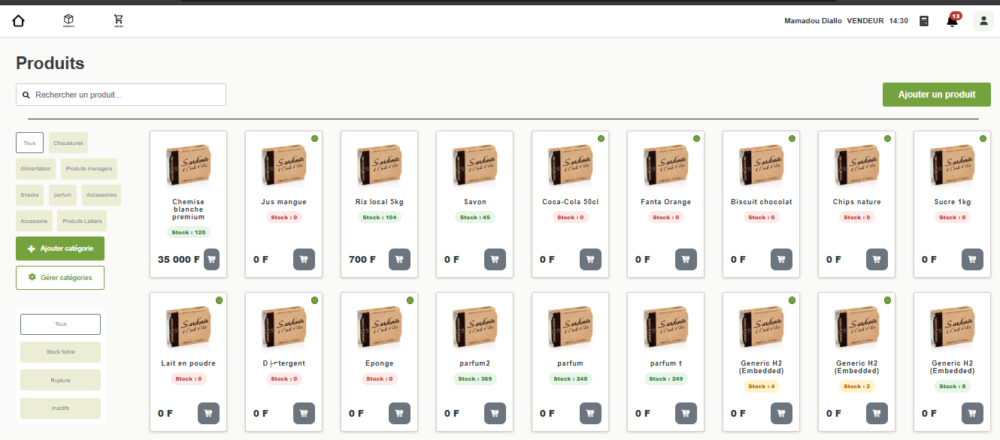
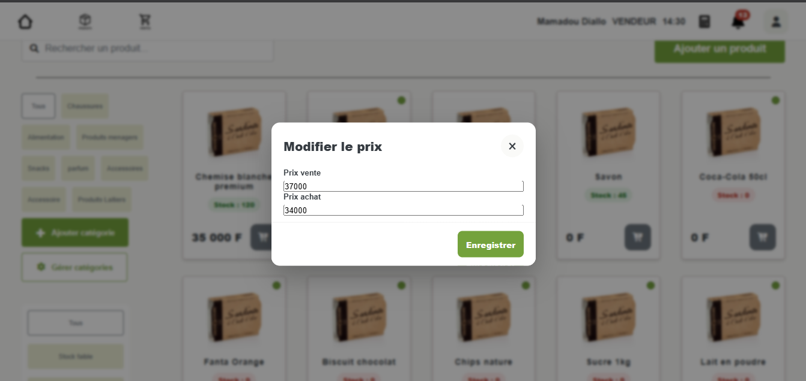
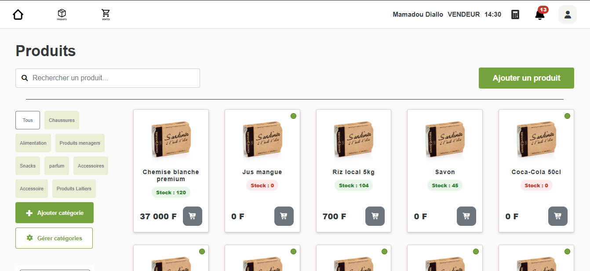
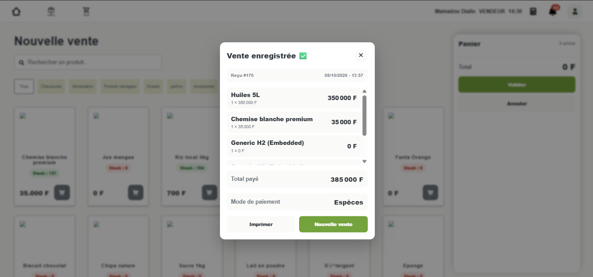
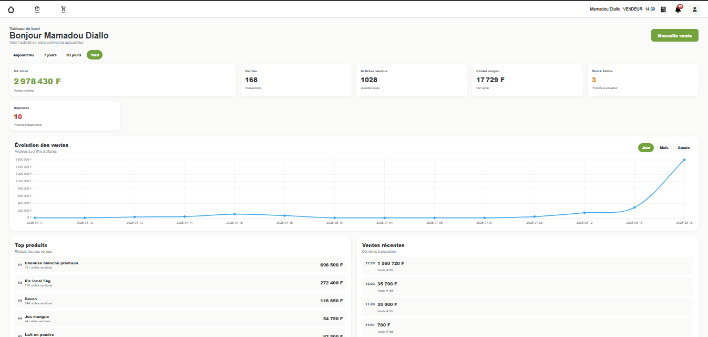

# 9. Validation fonctionnelle du MVP

## 9.1 Démarche de validation

La validation du MVP a été conduite au fil du développement, à partir des parcours métier définis au chapitre 3. Elle consistait à exécuter les opérations dans l'interface Thymeleaf, à observer les résultats et à corriger les anomalies détectées avant de reprendre le scénario.

Cette étape concerne la **validation fonctionnelle du monolithe**, et non une campagne de tests unitaires automatisés. Les tests techniques des API et de l'architecture microservices sont présentés avec les évolutions correspondantes, notamment au chapitre 15.

Le tableau ci-dessous synthétise les principales vérifications effectuées.

| Domaine | Scénario fonctionnel | Résultat attendu |
|---|---|---|
| Authentification | Saisir un PIN valide, puis un PIN invalide | Ouverture de session dans le premier cas, refus dans le second |
| Utilisateurs | Créer ou modifier un utilisateur, désactiver un compte, tenter un PIN déjà utilisé | Données actualisées, contrôle de l'unicité du PIN |
| Catégories et produits | Ajouter ou modifier une catégorie et un produit | Catalogue et rattachement à la catégorie mis à jour |
| Prix | Modifier le prix de vente d'un produit | Nouveau prix actif affiché, ancien tarif clôturé dans l'historique |
| Vente | Ajouter des articles, ajuster les quantités et valider | Vente et lignes enregistrées, reçu affiché, stock ajusté |
| Stock | Ajouter du stock et vendre un article | Quantité disponible mise à jour ; vente refusée si quantité insuffisante |
| Tableau de bord | Consulter les indicateurs après des ventes | Données et graphiques actualisés selon les opérations enregistrées |

Les captures suivantes illustrent les résultats **visibles dans l'interface**. Elles ne constituent pas, à elles seules, une preuve des écritures SQL ou de toutes les conditions métier énumérées dans le tableau.

## 9.2 Catalogue et contrôle du stock

La consultation de la page Produits permet de vérifier la présence des articles, leur prix courant et leur état de stock. Les produits en rupture sont identifiables dans l'interface, ce qui facilite le contrôle visuel des disponibilités.

*Figure 9.1 — Catalogue du MVP : prix affichés et niveaux de stock.*

Cette vérification a été complétée, au cours du développement, par des opérations de création et de modification de produits et de catégories, ainsi que par des changements de quantité en stock.

## 9.3 Modification d'un prix

L'historisation des prix répond à une règle importante : modifier le tarif d'un produit ne doit pas modifier rétroactivement le prix enregistré dans les ventes antérieures.

Le scénario illustré concerne la **Chemise blanche premium**. Son prix de vente initial est de **35 000 F**. Dans la fenêtre de modification, un nouveau prix de vente de **37 000 F** et un prix d'achat de **34 000 F** sont saisis. Après enregistrement, le catalogue affiche **37 000 F**.

| Saisie du nouveau tarif | Tarif actualisé dans le catalogue |
|:---:|:---:|
|  |  |

*Figure 9.2 — Modification du prix de vente et affichage du nouveau tarif actif.*

Les captures prouvent la modification visible du tarif. La conservation de l'ancien prix repose sur la logique de `ProductPrice` décrite au chapitre 8 et nécessite, pour être vérifiée indépendamment, la consultation des données persistées.

Une anomalie rencontrée pendant le développement concernait la contrainte d'unicité du prix actif. La correction a consisté à clôturer l'ancien prix et à synchroniser cette modification avec la base avant l'insertion du nouveau tarif.

## 9.4 Validation d'une vente

La vente constitue le parcours métier principal du MVP : sélectionner des produits, renseigner les quantités, confirmer l'opération et obtenir un récapitulatif.

*Figure 9.3 — Vente n° 170 validée et reçu affiché.*

Le reçu de la vente **n° 170**, datée du **8 octobre 2026 à 13 h 57**, affiche un montant de **385 000 F** et un règlement en espèces. Il permet de constater la confirmation de l'opération et la restitution de ses lignes à l'écran.

Les vérifications métier ont également porté sur la récupération du prix actif au moment de la vente, sa conservation dans chaque `SaleItem` et la mise à jour du stock. Ces traitements sont détaillés au chapitre 8 ; la capture du reçu ne prouve pas à elle seule leur exécution en base de données.

## 9.5 Consultation du tableau de bord

Le tableau de bord regroupe les indicateurs nécessaires au suivi du commerce : chiffre d'affaires, nombre de ventes, articles vendus, panier moyen, alertes de stock, évolution des ventes, produits les plus vendus et transactions récentes.

*Figure 9.4 — Indicateurs et graphiques du tableau de bord du MVP.*

La capture atteste de l'affichage des indicateurs et de leurs représentations graphiques. Le contrôle de leur exactitude suppose de rapprocher les valeurs affichées des ventes et lignes de vente enregistrées, notamment selon le statut des transactions et la période retenue.

## 9.6 Bilan de la validation fonctionnelle

Cette phase a permis de confronter les parcours du MVP aux besoins exprimés : consulter le catalogue, suivre les quantités, faire évoluer les prix, enregistrer une vente et consulter les résultats commerciaux. Les anomalies détectées ont donné lieu à des corrections suivies de nouvelles vérifications.

La validation fonctionnelle a constitué une étape de stabilisation avant la séparation de l'interface et du backend en V1. Les **tests techniques automatisés**, les vérifications d'API et les essais de la V2 sont présentés dans les chapitres consacrés à ces évolutions, afin de ne pas confondre les preuves propres à chaque phase du projet.
