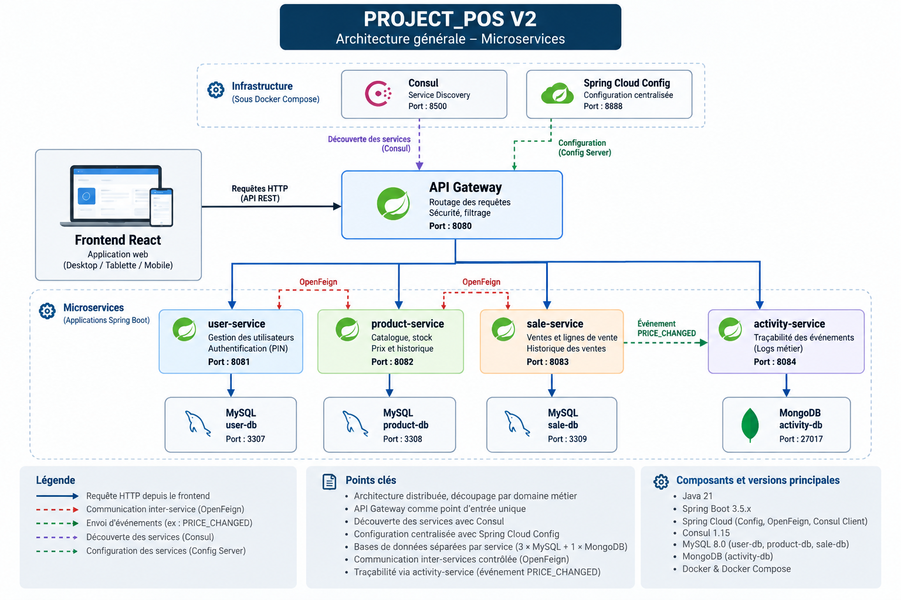

# 12. Architecture V2 : passage aux microservices

## 12.1 Objectif et choix d'architecture

Après la séparation du frontend React et du backend REST en V1, la V2 répartit les responsabilités du backend entre des services indépendants. Cette évolution ne vise pas à recréer les fonctionnalités du MVP : elle conserve ses règles métier, notamment l'historisation des prix et l'enregistrement du prix unitaire lors d'une vente.

Ce choix répond à un objectif de conception et de formation CDA : expérimenter la communication réseau entre services, l'isolation des données, la découverte de services et les conséquences des transactions réparties. Il ne signifie pas que les microservices seraient, par principe, plus adaptés qu'un monolithe à la taille actuelle du projet.

## 12.2 Vue globale de la V2



*Figure 12.1 — Architecture générale de PROJECT_POS V2.*

Le frontend React utilise une **API Gateway** comme point d'entrée du backend. Celle-ci dirige les requêtes vers les services métier :

| Service | Responsabilité principale | Stockage |
|---|---|---|
| `user-service` | Utilisateurs, rôles et authentification par PIN | MySQL (`pos_user_db`) |
| `product-service` | Produits, catégories, prix et stock | MySQL (`pos_product_db`) |
| `sale-service` | Ventes et lignes de vente | MySQL (`pos_sale_db`) |
| `activity-service` | Traces d'événements métier | MongoDB (`pos_activity_db`) |

**Consul** permet aux applications de se découvrir par nom logique ; **Spring Cloud Config Server** centralise leurs configurations. Les bases sont isolées : un service ne modifie pas directement les tables d'un autre.

Par exemple, `sale-service` conserve un identifiant de produit et un identifiant d'utilisateur, sans clé étrangère SQL vers les bases de `product-service` et `user-service`. Il obtient les informations nécessaires au moyen de leurs API.

## 12.3 Communication interservices : exemple d'une vente

La création d'une vente met en jeu plusieurs responsabilités : vérifier les informations du produit, demander le retrait du stock et enregistrer la transaction avec le prix appliqué. `sale-service` orchestre le processus, mais **le stock reste sous la responsabilité de `product-service`**.

### 12.3.1 Déclaration des clients OpenFeign

**Source :** `microservices/sale-service/src/main/java/com/projectpos/saleservice/` — `ProductClient.java` et `UserClient.java`.

```java
@FeignClient(name = "product-service")
public interface ProductClient {

    @GetMapping("/api/v1/products/{id}")
    ProductResponse findById(@PathVariable("id") Integer id);

    @PostMapping("/api/v1/products/stock/remove")
    void removeStock(@RequestBody RemoveStockRequest request);
}
```

`@FeignClient(name = "product-service")` désigne le service cible par son nom logique. L'annotation `@GetMapping` associe `findById` à une lecture HTTP ; `@PostMapping` associe `removeStock` à une demande de modification du stock. OpenFeign prend en charge la construction de ces appels à partir de l'interface Java.

```java
@FeignClient(name = "user-service")
public interface UserClient {

    @GetMapping("/api/v1/auth/me")
    CurrentUserResponse getCurrentUser(
            @RequestHeader("Cookie") String cookie
    );
}
```

Ici, l'en-tête HTTP `Cookie` est transmis explicitement pour permettre à `user-service` de retrouver la session de l'utilisateur. Ce mécanisme suppose que la session soit correctement reconnue côté service destinataire ; l'interface seule ne démontre pas toute la configuration de sécurité.

### 12.3.2 Orchestration dans `SaleService`

**Source :** `microservices/sale-service/src/main/java/com/projectpos/saleservice/sale/service/SaleService.java`.

```java
ProductResponse product =
        productClient.findById(itemRequest.productId());

if (product.salePrice() == null) {
    throw new IllegalArgumentException(
            "Aucun prix actif pour " + product.name()
    );
}

productClient.removeStock(
        new RemoveStockRequest(
                itemRequest.productId(),
                itemRequest.quantity()
        )
);

SaleItem item = new SaleItem();
item.setSale(sale);
item.setProductId(product.id());
item.setQuantity(itemRequest.quantity());
item.setUnitPrice(product.salePrice());
sale.getItems().add(item);
```

Trois instructions matérialisent la frontière entre les domaines :

1. `productClient.findById(...)` récupère les données du produit, notamment son prix actif ; l'absence de prix déclenche une exception.
2. `productClient.removeStock(...)` **demande** au service propriétaire de diminuer le stock. `sale-service` n'exécute pas de requête SQL sur `pos_product_db`.
3. `item.setUnitPrice(product.salePrice())` copie le prix dans la ligne de vente. Ce prix historisé ne change pas lorsque le catalogue est mis à jour ultérieurement.

Ces lignes sont un **extrait** du traitement, pas la méthode complète : elles ne suffisent pas à démontrer toutes les vérifications, la gestion des erreurs réseau ou le moment exact de la sauvegarde de la vente.

## 12.4 API Gateway, découverte et configuration

L'**API Gateway**, exposée sur le port `8080` dans l'environnement décrit, fournit une adresse commune au frontend. Les routes présentées dans la V2 couvrent notamment `/api/v1/users/**`, `/api/v1/auth/**`, `/api/v1/products/**`, `/api/v1/categories/**`, `/api/v1/sales/**` et `/api/v1/activities/**`.

**Consul** reçoit l'enregistrement des services au démarrage et permet leur résolution par nom logique. Il complète ainsi l'utilisation de `@FeignClient(name = "product-service")`, sans imposer une adresse IP fixe dans l'interface Java.

**Config Server** fournit une configuration centralisée depuis un dépôt Git dédié. Les valeurs propres à l'environnement sont séparées du code applicatif ; les secrets sont prévus pour être injectés par variables d'environnement plutôt que conservés en clair dans ce dépôt.

Ces composants répondent à trois problèmes différents : **orienter les requêtes externes** (Gateway), **localiser les services** (Consul) et **fournir leur configuration** (Config Server).

## 12.5 Environnement Docker Compose

L'infrastructure de développement est démarrée avec Docker Compose : **Consul, Config Server, trois instances MySQL et MongoDB**. Les services applicatifs peuvent, quant à eux, être lancés depuis IntelliJ IDEA pour faciliter le débogage.

Docker Compose décrit un ensemble de services et leur environnement d'exécution dans un fichier YAML. Pour chaque conteneur, la configuration peut préciser une image ou une construction, les ports publiés, les variables d'environnement, les volumes et les dépendances de démarrage.

Dans PROJECT_POS, les trois instances MySQL séparent physiquement les bases de `user-service`, `product-service` et `sale-service`. MongoDB est utilisé par `activity-service`. Les ports publiés permettent de joindre ces composants depuis le poste de développement.

| Composant | Port de développement |
|---|---:|
| API Gateway | 8080 |
| `user-service` / `product-service` / `sale-service` / `activity-service` | 8081 / 8082 / 8083 / 8084 |
| Config Server / Consul | 8888 / 8500 |
| MySQL utilisateur / produit / vente | 3307 / 3308 / 3309 |
| MongoDB | 27017 |

**Point technique important :** publier un port rend un service accessible depuis l'hôte, mais n'assure pas qu'il soit prêt à répondre. De même, l'ordre de démarrage des conteneurs ne garantit pas, à lui seul, la disponibilité de MySQL ou de Config Server. La gestion effective de cette disponibilité dépend des vérifications de santé et des mécanismes de reconnexion configurés.

La description ci-dessus explique l'organisation constatée dans le dossier ; pour montrer les directives exactes (`services`, `ports`, `environment`, `volumes`, `healthcheck` ou `depends_on`), il faudra sélectionner un extrait authentique du fichier Compose du dépôt. Il ne serait pas pertinent de présenter un YAML reconstitué comme une preuve de réalisation.

## 12.6 Cohérence des données : transactions distribuées

### 12.6.1 Pourquoi une transaction locale ne suffit plus

Dans le monolithe, une transaction SQL pouvait regrouper les modifications effectuées dans une même base. Dans la V2, **le retrait du stock** est enregistré dans `pos_product_db`, tandis que **la vente** est enregistrée dans `pos_sale_db`.

Même si la méthode de `sale-service` utilise `@Transactional`, cette annotation ne peut pas, à elle seule, annuler une transaction déjà validée dans la base de `product-service` après un appel HTTP. Chaque service possède sa propre frontière transactionnelle.

### 12.6.2 Scénarios d'échec identifiés

| Moment de l'échec | Conséquence possible |
|---|---|
| `product-service` refuse le retrait de stock avant modification | La vente doit être interrompue ; aucun stock ne devrait être retiré si le service garantit l'atomicité locale. |
| Le stock est retiré, puis la sauvegarde de la vente échoue | **Stock diminué sans vente enregistrée** : incohérence entre les deux bases. |
| Le retrait réussit, mais la réponse HTTP est perdue ou expire | `sale-service` peut ignorer si le stock a réellement été retiré ; une relance non maîtrisée risque un second retrait. |
| Plusieurs lignes sont traitées et une opération ultérieure échoue | Les retraits déjà effectués peuvent subsister alors que la vente complète n'est pas enregistrée. |

Le code présenté en 12.3 montre précisément l'ordre **appel de retrait du stock → construction de `SaleItem`**. Il ne démontre pas la présence d'un mécanisme de compensation, d'une clé d'idempotence ou d'une transaction distribuée.

### 12.6.3 Choix retenu et portée de la V2

**Le choix actuel est une orchestration synchrone par appels REST, sans garantie d'atomicité globale démontrée entre les bases.** Ce n'est pas une simple indisponibilité accessoire : c'est un risque d'intégrité métier qui rend ce processus insuffisant, en l'état, pour une exploitation commerciale exigeant une cohérence garantie.

Une évolution crédible consisterait à introduire une **Saga avec compensation** : si l'enregistrement de la vente échoue après le retrait, une opération explicite de restitution du stock serait demandée à `product-service`. Il faudrait également rendre les opérations **idempotentes**, pour qu'une répétition de requête après un délai réseau ne produise pas deux retraits.

Une autre approche pourrait combiner événements métier, **Outbox Pattern** et traitement asynchrone pour fiabiliser les échanges. Ces solutions sont des pistes d'évolution, **pas des mécanismes revendiqués comme déjà implémentés**.

Cette décision de périmètre est assumée pour la démonstration CDA ; elle doit être corrigée avant d'utiliser la V2 comme système transactionnel de production.

## 12.7 Journal d'activité et tolérance aux pannes

`activity-service` conserve des événements métier dans MongoDB. Le dossier décrit notamment l'envoi d'un événement `PRICE_CHANGED` depuis `product-service` lorsqu'un prix est modifié.

Le choix retenu est de ne pas faire échouer la modification du prix lorsque le service de journalisation est indisponible. **L'opération métier est donc prioritaire sur la disponibilité de la trace d'activité.** En contrepartie, un événement non transmis n'est pas automatiquement rejoué dans l'implémentation décrite.

Cette décision doit être distinguée du problème précédent : perdre une trace d'activité n'a pas la même conséquence métier que décrémenter un stock sans enregistrer une vente. Pour rendre la journalisation fiable, une publication persistée, par exemple avec un Outbox Pattern, serait à envisager.

## 12.8 Bilan et articulation avec la suite du dossier

La V2 a permis de mettre en pratique le découpage par domaines, les API REST entre services, OpenFeign, Consul, Config Server, l'API Gateway et l'isolation des données SQL/NoSQL. Elle montre également le coût de cette séparation : dépendances réseau, démarrage de plusieurs composants et absence de transaction unique entre les bases.

Le principal enseignement architectural est concret : **une séparation correcte des responsabilités ne garantit pas, à elle seule, la cohérence d'une opération métier distribuée**. Les chapitres suivants approfondissent la sécurité, la persistance et les validations techniques de cette architecture.
