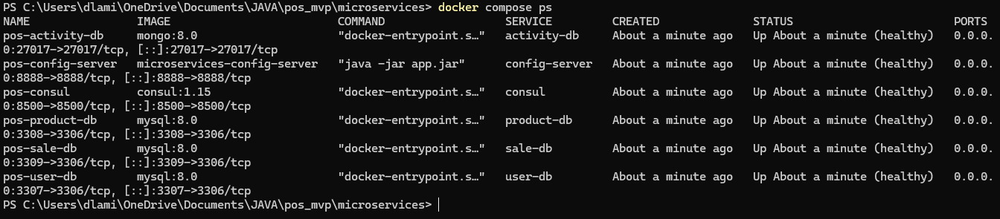
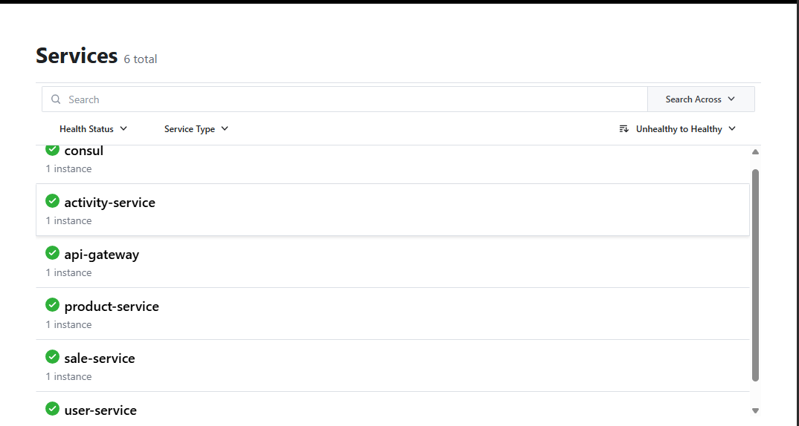
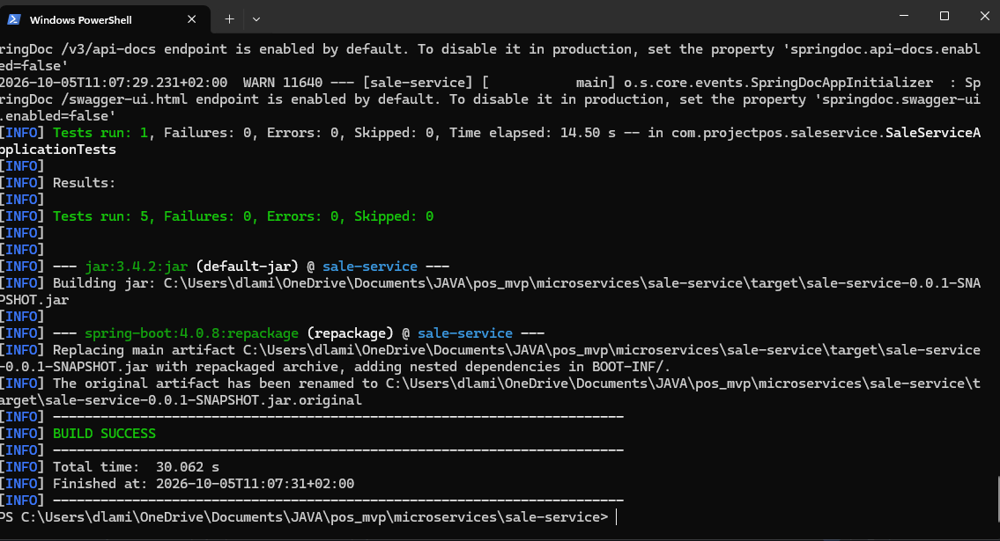
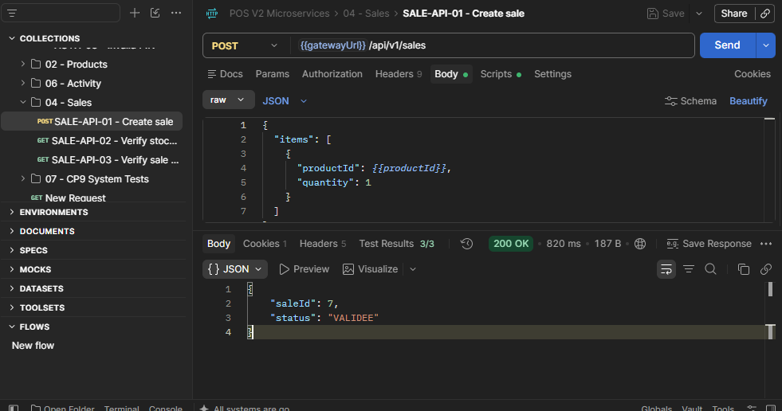
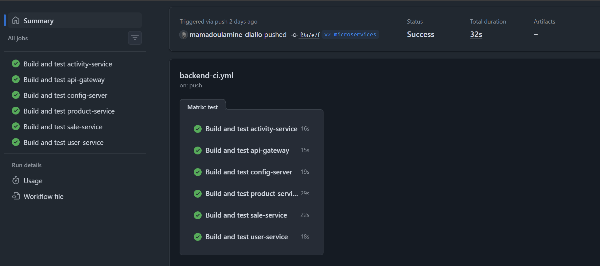

# 15. Déploiement, validation technique et démarche DevOps

## 15.1 Environnement de validation de la V2

Le passage aux microservices a introduit des dépendances entre applications, bases de données et services d'infrastructure. Pour reproduire cet environnement, PROJECT_POS utilise **Docker Compose** pour les composants techniques et **IntelliJ IDEA** pour l'exécution des applications Spring Boot pendant le développement.

| Infrastructure Docker | Applications exécutées pendant le développement |
|---|---|
| Consul, Config Server | `api-gateway` |
| MySQL : `user-db`, `product-db`, `sale-db` | `user-service`, `product-service`, `sale-service` |
| MongoDB : `activity-db` | `activity-service` |

Le fichier `microservices/docker-compose.yml` centralise la définition des conteneurs, de leurs ports, des volumes et des contrôles de santé. Les bases utilisent des **volumes nommés** : la commande `docker compose down` arrête et supprime les conteneurs, sans effacer ces volumes en l'absence de l'option `-v`.

Les secrets ont également été retirés des valeurs littérales du fichier Compose. Le mot de passe MySQL est référencé par `${MYSQL_ROOT_PASSWORD}`, alimenté localement par un fichier `.env` exclu de Git. Cette mesure limite l'exposition de secrets dans les fichiers versionnés ; elle ne remplace pas une gestion centralisée des secrets en production.

## 15.2 Démarrage et contrôles de santé

L'infrastructure est démarrée depuis le répertoire `microservices` :

```bash
docker compose up -d
docker compose ps
```

Les trois instances MySQL sont contrôlées avec `mysqladmin ping`, MongoDB avec `db.adminCommand('ping')`, Consul avec `consul members` et le Config Server avec son endpoint de santé. La campagne documentée a abouti à **six conteneurs sur six en état `healthy`**.



*Figure 15.1 — Infrastructure V2 : six conteneurs déclarés sains.*

Les cinq applications Spring Boot sont ensuite démarrées. Leur présence dans Consul confirme leur enregistrement auprès du registre de services, sans prouver à elle seule le bon fonctionnement de tous les parcours métier.



*Figure 15.2 — Les cinq applications V2 enregistrées dans Consul.*

Un **smoke test** complète cette vérification : `GET http://localhost:8080/api/v1/products` doit retourner `HTTP 200` à travers l'API Gateway. Il sollicite ainsi le routage et le service produit, au-delà du simple démarrage des processus.

## 15.3 Tests automatisés et isolation de l'environnement

La V2 comprend des tests automatisés ciblant les services métier et le journal d'activité. Ils permettent de vérifier les règles fonctionnelles, de détecter les régressions et de sécuriser les modifications apportées aux microservices.

Les tests sont réalisés avec **JUnit 5**, pour l'exécution des scénarios et les assertions, et **Mockito**, pour simuler les dépendances externes telles que les repositories et les clients de communication interservices.

Le plan de validation est documenté dans `docs/tests/plan-tests-v2.md`.

| Module | Tests ciblés documentés | Périmètre |
|---|---:|---|
| `product-service` | 8 | Produits et gestion des prix |
| `sale-service` | 4 | Création des ventes et règles métier |
| `user-service` | 6 | Gestion des utilisateurs |
| `activity-service` | 4 | Contrôleur et journal d'activité |
| **Total** | **22** | Hors tests de chargement du contexte Spring |

### Illustration : test automatisé du ProductPriceService

Le `ProductPriceService` gère les changements de prix tout en conservant leur historique. Une règle métier impose qu'un produit ne possède qu'un seul prix actif à un instant donné.

Lors du développement, une erreur SQL liée à une contrainte d'unicité avait été rencontrée. La correction consiste à clôturer l'ancien prix, synchroniser cette modification avec la base de données, puis enregistrer le nouveau prix actif.

Un test de non-régression a été développé afin de vérifier cet enchaînement.

**Extrait de `ProductPriceServiceTest.java` :**

```java
@Test
void shouldCloseCurrentPriceBeforeCreatingNewPrice() {

    // Préparation du produit et de son prix actif
    Product product = new Product();
    product.setId(7);
    product.setName("Chemise");

    ProductPrice currentPrice = new ProductPrice();
    currentPrice.setProduct(product);
    currentPrice.setSalePrice(new BigDecimal("25000"));
    currentPrice.setPurchasePrice(new BigDecimal("18000"));
    currentPrice.setEndDate(null);

    when(repository.findByProductIdAndEndDateIsNull(7))
            .thenReturn(Optional.of(currentPrice));

    productPriceService.changePrice(
            7,
            new BigDecimal("28000"),
            new BigDecimal("20000")
    );

    assertNotNull(currentPrice.getEndDate());

    InOrder inOrder = inOrder(repository);

    inOrder.verify(repository).save(currentPrice);
    inOrder.verify(repository).flush();

    ArgumentCaptor<ProductPrice> priceCaptor =
            ArgumentCaptor.forClass(ProductPrice.class);

    inOrder.verify(repository).save(priceCaptor.capture());

    ProductPrice newPrice = priceCaptor.getValue();

    assertNotSame(currentPrice, newPrice);
    assertEquals(
            new BigDecimal("28000"),
            newPrice.getSalePrice()
    );
    assertEquals(
            new BigDecimal("20000"),
            newPrice.getPurchasePrice()
    );
    assertNull(newPrice.getEndDate());
    assertSame(product, newPrice.getProduct());
    assertNotNull(newPrice.getStartDate());
}
```

Ce test vérifie que l'ancien prix est clôturé et que le nouveau prix possède les valeurs attendues.

La méthode **`InOrder`** de Mockito contrôle l'ordre des opérations : sauvegarde de l'ancien prix, appel à `flush()`, puis sauvegarde du nouveau prix.

L'utilisation d'**`ArgumentCaptor`** permet de récupérer l'objet transmis au repository et de vérifier ses propriétés.

Ce test protège ainsi la correction apportée à la gestion des prix actifs. Le repository étant simulé, la contrainte d'unicité SQL elle-même nécessiterait un test d'intégration avec une base réelle.

La classe comporte également trois scénarios complémentaires :

| Scénario | Comportement vérifié |
|---|---|
| Changement de prix | Clôture de l'ancien prix et création du nouveau dans le bon ordre |
| Publication d'activité | Transmission d'un événement `PRICE_CHANGED` avec les anciens et nouveaux montants |
| Indisponibilité d'`activity-service` | L'échec du service secondaire ne provoque pas la propagation d'une exception par le changement de prix |
| Absence de prix actif | Rejet de l'opération sans sauvegarde ni émission d'événement |

Ces tests couvrent à la fois le fonctionnement nominal, la traçabilité métier et certains comportements d'erreur dans l'architecture distribuée.

### Exécution des tests avec Maven

Maven permet d'intégrer les tests automatisés au cycle de construction de chaque microservice.

La commande :

```bash
./mvnw test
```

compile les classes nécessaires et exécute les tests détectés par le moteur de test configuré.

Pour une validation plus complète, la commande suivante est utilisée :

```bash
./mvnw clean verify
```

Elle enchaîne le nettoyage des fichiers générés, la compilation, les tests, la construction de l'application et les vérifications supplémentaires configurées.

**L'intérêt de Maven est de rendre cette validation reproductible**, indépendamment de l'IDE utilisé. Les mêmes commandes peuvent être exécutées localement ou automatiquement dans GitHub Actions.

En cas d'échec d'un test, Maven interrompt normalement la construction et produit des rapports permettant d'identifier l'anomalie.



*Figure 15.3 — Exécution Maven réussie sur `sale-service`, comprenant cinq tests, dont le périmètre diffère légèrement des quatre tests métier recensés dans le plan de validation.*

### Isolation de l'environnement de test

La mise en place de l'intégration continue a révélé plusieurs dépendances implicites à l'environnement local.

Les tests nécessitant un contexte Spring pour les services SQL ont été configurés avec **H2 en mémoire** et un profil `test`, défini dans `src/test/resources/application-test.yml`.

Les composants Spring Cloud Config et Consul sont désactivés pour les tests qui n'en ont pas besoin. Le `config-server` utilise quant à lui un backend `native` en environnement de test, évitant toute dépendance à un dépôt Git distant.

Cette configuration permet d'exécuter les tests sur un runner GitHub Actions sans démarrer les bases MySQL ni l'ensemble de l'infrastructure distribuée.

Elle améliore la reproductibilité des tests, sans remplacer les validations d'intégration réalisées avec les composants réels.

**L'association de JUnit 5, Mockito et Maven permet ainsi de vérifier automatiquement les règles métier, de protéger les corrections apportées et de sécuriser les évolutions de PROJECT_POS V2.**

## 15.4 Validation des parcours interservices

Les essais réalisés avec Postman complètent les tests automatisés en vérifiant des requêtes HTTP réelles à travers la Gateway.

| Parcours | Vérification effectuée |
|---|---|
| Authentification | Connexion, utilisateur courant, rejet d'un PIN invalide |
| Produits | Consultation, stock, prix actif et historique des prix |
| Vente | Création de vente, décrémentation du stock, consultation du détail |
| Activités | Consultation de l'événement `PRICE_CHANGED` via la Gateway |
| Accès protégé | Rejet d'une création de vente sans session valide : `HTTP 401` |



*Figure 15.4 — Vente validée via la Gateway ; stock passé de cinq à quatre unités.*

Un défaut d'intégration a été découvert pendant cette campagne : la Gateway ne possédait pas de route vers `activity-service`. L'ajout du chemin `/api/v1/activities/**` avec la destination `lb://activity-service` a rétabli l'accès au journal. Ce cas montre pourquoi un service fonctionnel isolément ne suffit pas à valider un parcours distribué.

Les tests fonctionnels ne démontrent pas, à eux seuls, l'atomicité d'une vente entre plusieurs bases. Les scénarios d'échec de cette opération et le choix d'architecture associé sont détaillés au chapitre 12.

## 15.5 Mesures de performance locales

Deux campagnes d'environ une minute ont été exécutées sur une machine hébergeant à la fois les services, l'infrastructure et le générateur de charge.

| Mesure | 1 utilisateur virtuel | 3 utilisateurs virtuels |
|---|---:|---:|
| Requêtes | 853 | 4 033 |
| Débit | 14,24 req/s | 67,53 req/s |
| Temps moyen | 16 ms | 15 ms |
| P95 | 27 ms | 23 ms |
| P99 | 33 ms | 45 ms |
| Échecs | 0 | 0 |
| CPU maximum | 47,8 % | 74,5 % |
| RAM observée | 95,3 % | 91 % |

Ces résultats montrent qu'aucun échec n'a été relevé dans les deux scénarios exécutés. **Ils ne constituent pas une mesure de capacité en production** : les charges restent limitées et la mémoire du poste était fortement sollicitée. La campagne a donc été arrêtée sans augmenter davantage le nombre d'utilisateurs virtuels.

## 15.6 Intégration continue avec GitHub Actions

Le workflow `.github/workflows/backend-ci.yml` est déclenché par les `push` et les `pull requests` ciblant la branche `v2-microservices`. Il utilise une **matrice de six applications Maven** : `activity-service`, `api-gateway`, `config-server`, `product-service`, `sale-service` et `user-service`.

Le runner utilise Ubuntu 24.04, Java 21 (Temurin) et le Maven Wrapper. Chaque job exécute notamment :

```bash
chmod +x mvnw
./mvnw clean verify
```

Le pipeline n'a pas fonctionné dès sa première exécution. Trois familles d'incidents ont été corrigées :

| Incident constaté | Cause | Correction |
|---|---|---|
| Code de sortie `126` | `mvnw` non exécutable sous Linux | `chmod +x mvnw` |
| Échec des tests SQL | Dépendance à MySQL local | Profil de test avec H2 |
| Échec de démarrage Spring | Config Server ou configuration Git indisponible | Désactivation ciblée de Config/Consul et profil `native` |

La résolution de ces incidents a rendu les six projets testables sur un runner indépendant du poste Windows de développement. La dernière exécution documentée affiche **six jobs réussis sur six**.



*Figure 15.5 — Pipeline GitHub Actions : six jobs Maven réussis.*

Cette chaîne réalise de **l'intégration continue (CI)** : compilation et tests automatiques après modification du code. Elle ne déploie pas encore automatiquement les applications dans un environnement distant et ne doit donc pas être présentée comme un déploiement continu (CD).

## 15.7 Bilan technique

La démarche DevOps de la V2 a produit trois résultats concrets : un environnement d'infrastructure reproductible avec Docker Compose, une validation combinant tests automatisés et parcours HTTP, et une CI capable de contrôler indépendamment les six applications Maven.

Les incidents rencontrés pendant la mise en place de GitHub Actions ont eu une valeur technique particulière : ils ont révélé les dépendances implicites à Windows, aux bases locales et à la configuration distante. Leur correction a amélioré la portabilité du projet.

La prochaine étape, hors du périmètre réalisé, serait la construction et la publication d'images applicatives, suivies d'un déploiement automatisé vers un environnement de recette et de tests après déploiement.
